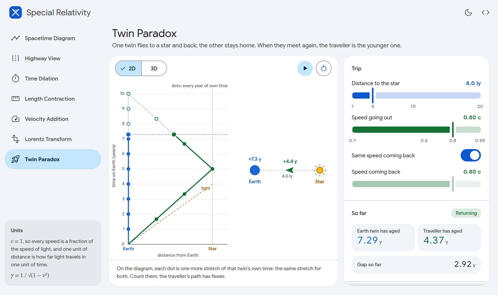

# Special Relativity Simulator

**Live:** https://alltawd.github.io/special-relativity-sim/

<picture>
  <source media="(prefers-color-scheme: dark)" srcset="docs/screenshot-dark.png" />
  
</picture>

Seven interactive simulations of special relativity in the browser, in natural
units (c = 1). Plain TypeScript with Vite, Canvas 2D for the figures and three.js
for the 3D views. No framework, no server.

| Simulation | What it shows |
| --- | --- |
| Spacetime Diagram | A Minkowski diagram with a second frame; place events and compare their coordinates |
| Highway View | Objects and clocks on a road, in lanes by speed, beside their worldlines |
| Time Dilation | Two light clocks, one moving: the longer path of its photon is the slower tick |
| Length Contraction | A ship measured at rest and in flight against a ruler |
| Velocity Addition | A race against light, and a chart of the everyday rule against the real one |
| Lorentz Transform | Type in an event and follow the arithmetic into the other frame |
| Twin Paradox | A trip to a star and back, with each twin's age along the way |

```bash
npm install
npm run dev      # http://localhost:5173
npm test         # physics unit tests (Vitest)
npm run build    # type-check + production build into dist/
```

## Structure

```
src/
├── physics/
│   ├── lorentz.ts         pure functions: gamma, boost, interval, light clock, twin paradox…
│   └── lorentz.test.ts    unit tests: the physics is checked before anything is drawn
├── sims/
│   ├── types.ts           the Sim interface: { id, title, blurb, icon, mount(root) => cleanup }
│   ├── index.ts           the list of simulations, in navigation order
│   ├── spacetime-diagram.ts, highway.ts, time-dilation.ts, length-contraction.ts,
│   │   velocity-addition.ts, lorentz-transform.ts, twin-paradox.ts
│   └── kit.ts             every control on one page (#kit, in `npm run dev` only)
├── ui/
│   ├── controls.ts        slider, switch, buttons, segmented, fields, canvas sizing
│   ├── layout.ts          the workbench (figure + panel), groups, readouts, typeset math
│   ├── playback.ts        play / pause / reset and the animation loop
│   ├── views.ts           the 2D / 3D switch
│   ├── stage3d.ts         the three.js scene behind a 3D view (loaded on demand)
│   ├── draw.ts            canvas helpers: theme colours, text, arrows, photons
│   ├── icons.ts           Material Symbols paths
│   └── theme.ts           light / dark
├── styles/
│   ├── tokens.css         every colour, font and shape, for both themes
│   ├── shell.css          app bar, navigation, page header
│   ├── kit.css            the workbench and every control
│   └── fonts.css          Google Sans Flex and STIX Two Text, self-hosted
└── main.ts                navigation + hash routing (#spacetime, #twin, …)
```

**Rule:** all physics goes in `src/physics/` with a test. A simulation only reads
numbers from there and draws them.

## Design

The interface follows [Material Design 3](https://m3.material.io/), in the style
of Google's web apps: a tinted page with white rounded panes on it, pill-shaped
buttons and navigation, one blue primary colour, Google Sans for text and
Material Symbols for icons. `styles/tokens.css` holds the colour roles
(`--primary`, `--secondary-container`, `--on-surface`, …) for the light and the
dark theme; nothing else in the project names a colour.

Each simulation sits in a **workbench**: a figure pane with a controls pane
beside it, sized to the window so that a control, the figure and the numbers it
changes are all on screen at once. On a phone the controls move under the figure
and the navigation becomes a row of scrolling tabs.

The physics palette is Google's four colours, each with one meaning everywhere:

| Colour | Token | Stands for |
| --- | --- | --- |
| blue | `--sim-timelike` | things at rest in S; timelike intervals |
| green | `--sim-prime` | the moving frame S′ and whatever rides in it |
| yellow | `--sim-light` | light |
| red | `--sim-spacelike` | spacelike intervals; “everyday” answers that are wrong |

A control takes the colour of what it controls (`tone: 'prime'` makes a slider
green), so the panel doubles as the legend for the figure. Things that differ in
colour also differ in shape or label, so nothing depends on colour vision alone.

Anything mathematical is set in STIX Two Text, the typeface physics journals use:
`math('t′ = γ(t − vx)')` italicises the variables and leaves numbers and
operators upright, as a textbook does.

## Building a simulation

`npm run dev`, then open http://localhost:5173/#kit to see every control and the
call that makes it. A simulation is put together like this:

```ts
import { gamma } from '../physics/lorentz';
import { el, fitCanvas, slider } from '../ui/controls';
import { backdrop, paint } from '../ui/draw';
import { bench, group, math, stat, stats } from '../ui/layout';
import { playback } from '../ui/playback';
import { dualView, type Stage3D } from '../ui/views';
import type { Sim } from './types';

function mount(root: HTMLElement): () => void {
  let v = 0.6; // state: plain variables
  let t = 0;

  const canvas = el('canvas');
  const gammaStat = stat(math('γ'));

  // Play / pause / reset. onStep gets the real time since the last frame.
  const player = playback({
    onStep: (dt) => { t += dt; update(); },
    onReset: () => { t = 0; update(); },
  });

  // Optional 3D view: three.js is only downloaded when someone asks for it.
  const views = dualView({ canvas, camera: [0, 4, 10], build: build3d, onChange: () => update() });

  root.append(bench({
    figure: [canvas, views.layer],
    toolbar: { start: [views.switcher], end: [player.el] },
    caption: ['What the figure shows, how to use it, and its units.'],
    panel: [
      group('Motion',
        slider({
          label: 'Velocity', min: 0, max: 0.99, step: 0.01, value: v, tone: 'prime',
          format: (x) => `${x.toFixed(2)} c`,
          onInput: (x) => { v = x; update(); },
        }),
        stats(gammaStat),
      ),
    ],
  }));

  // Sizes are in CSS pixels. Runs again on resize, theme change and font load.
  function draw(ctx: CanvasRenderingContext2D, width: number, height: number) {
    const p = paint(canvas); // theme colours and fonts, read fresh each frame
    backdrop(ctx, width, height, p);
    ctx.fillStyle = p.prime;
    ctx.fillRect(width / 2 + 40 * Math.sin(t) - 20 / gamma(v), height / 2 - 10, 40 / gamma(v), 20);
  }

  // Add meshes to stage.scene; return a function that moves them each frame.
  function build3d(stage: Stage3D): () => void {
    const { THREE, scene } = stage;
    const box = new THREE.Mesh(
      new THREE.BoxGeometry(2, 1, 1),
      new THREE.MeshStandardMaterial({ color: stage.color('--sim-prime') }),
    );
    scene.add(stage.grid(12, 12), box);
    return () => {
      box.position.x = 2 * Math.sin(t);
      box.scale.x = 1 / gamma(v);
    };
  }

  // Call after every change to the state.
  function update() {
    gammaStat.set(gamma(v).toFixed(3));
    view.redraw();
  }

  const view = fitCanvas(canvas, draw);
  update();

  return () => {
    player.stop();
    views.stop();
    view.stop();
    root.replaceChildren();
  };
}

export const example: Sim = { id: 'example', title: 'Example', icon: 'widgets', blurb: 'One line about it.', mount };
```

Then add it to the list in `sims/index.ts`. Also in `ui/`: `toggle`, `button`,
`iconButton`, `segmented`, `numberField`, `select`, `row`, `tag`, `inset`,
`explain`, `defs`, `legend`, `frac` and `formula`.

Before committing, check a new simulation in both themes (the button at the top
right) and at phone width.

## What changed from the original

The first version (Next.js + React, kept in `~/special-relativity-simulator`) had
the same seven simulations. This one was rebuilt on a tested physics module, and
a few of the originals turned out to be wrong:

- **Twin paradox** split Earth time evenly between the legs, which is wrong when the
  outbound and return speeds differ (test: 3 ly at 0.6c out, 0.8c back → 6.25 y aboard, not 6.125).
- **Time dilation** drew both light clocks bouncing at the same rate and slowed down
  only a number. The moving photon now really takes the longer path, at the speed of light.
- **Spacetime diagram**: the dashed light-cone lines ran to the corners of a 700×500
  canvas (≈35.5°, not 45°).
- **Lorentz transform** plotted transformed events with no sign of what stays the same.
  Each event now moves along the hyperbola of its invariant interval.
- 30 type errors were hidden by `ignoreBuildErrors: true`. This build runs `tsc` in strict mode.

## Ideas worth more than a port

- **Frame switching in Highway View.** It only shows the road's frame, so the
  relativity of simultaneity never appears. Let the user pick any object as the rest
  frame and `boost` every clock and position into it: clocks synchronized in one frame
  read different times in the other.
- **What you would actually see.** Include light-travel delay (and, in 3D, Terrell
  rotation) as a toggle next to the "measured" picture.
- **Spacetime Diagram:** draw lines of simultaneity through each event in S', and an
  option to redraw the whole diagram in S' (so S's axes become the tilted ones).

## Credits

[Material Symbols](https://github.com/google/material-design-icons) (Apache 2.0),
[Google Sans Flex](https://fonts.google.com/specimen/Google+Sans+Flex) and
[STIX Two](https://github.com/stipub/stixfonts) (SIL Open Font License 1.1),
[three.js](https://threejs.org/) (MIT).
